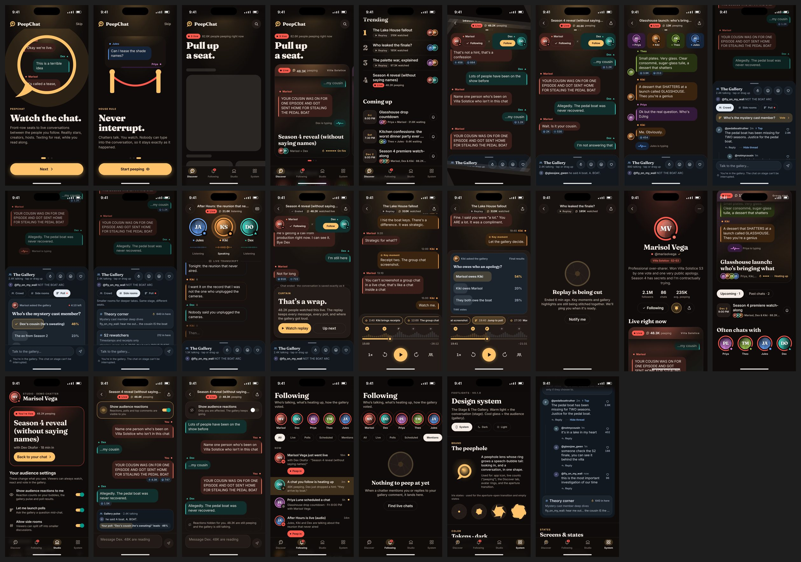

# PeepChat — Design concept v0.1 ("Footlights")

> **A social texting app where conversations become the content.**
> *Be a fly on the wall to your favorite chats.*

---

## 1. The one rule: the conversation stays intact

Every decision below serves this rule. In practice it means:

| Principle | How the UI enforces it |
|---|---|
| The chatters' exchange is the hero | It owns the **stage**: the full-bleed, warm-lit surface. Nothing from the audience is ever drawn *between* bubbles. |
| The audience has its own space | The **Gallery** is a separate, cool-toned glass sheet. It peeks at the bottom and never overlaps the latest message. |
| Viewers can't type into the chat | There is no composer on the viewer's stage at all. The only text field lives inside the Gallery and says so: *"You're in the gallery. The chat on stage can't be interrupted."* |
| Watching feels like a privilege | Entering a chat is an event (aperture-open transition). Live counts say "peeping", not "viewers". The stage is lit like a set. |
| Chatters control what *they* see | One switch in the chatter's view: **Show audience reactions**. Off hides reactions/polls/comments *for that chatter only*; the gallery carries on. |

## 2. Creative directions explored

| | Direction | Mood | Palette | Type | Rationale |
|---|---|---|---|---|---|
| **A ✅** | **Footlights** | A late-night stage. Warm key light on the talent, the house in shadow, the crowd behind glass. | Warm near-black "house" `#0E0B0A`, spotlight amber `#FFC46B`, tally-light red `#FF5A4E`; cool slate-glass for the Gallery `#121820` | **Fraunces** (soft, theatrical display serif) + **Inter** (UI) | Maps 1:1 onto "The Stage & The Gallery": *warm = stage, cool = crowd*. Temperature does the separating work, so we never need heavy borders or labels. |
| B | Surveillance Noir | Security-cam voyeurism, CRT scanlines, monochrome + acid green. | `#0A0D0A`, `#B7FF4A` | Space Grotesk + JetBrains Mono | Strongly "fly on the wall", but it reads creepy, not glamorous. Wrong for reality-TV talent and brand partners. |
| C | Paparazzi Flash | Tabloid energy, white-hot flash, magenta headlines. | `#FFFFFF`, `#FF2E88`, black | Anton + Inter | Loud and fun, but too close to existing social/tabloid aesthetics. Also fights the "never interrupt" calm the stage needs. |

**Chosen: A, Footlights.** It is the only one where the core product principle (two separate spaces) is expressed by the visual system itself (light temperature), not bolted on. It also avoids the generic purple-gradient "AI app" look: there is no purple anywhere in the brand palette.

## 3. Visual language

### The peephole (ownable shape)
A lens whose ring grows a short, curved **speech-bubble tail**: *looking in* and *a conversation* in one mark. It is used for:
- App icon and splash (`assets/`, generated from `assets/brand/*.svg` by `npm run icons`)
- Live counts: the peephole glyph + "**48.2K** peeping"
- The Discover tab icon (lit with amber when active)
- Avatar framing: the **aperture ring** around every chatter
- The **iris** (6-blade camera aperture) used for the open-chat transition and for empty states (a closed iris = nothing to peep at)

### Light as information
- **Spotlight** (`<Spotlight heat>`): a radial cone from above. `heat` (0–1) comes from the chat's activity, so hot chats literally glow brighter. On audio rooms the light takes the *active speaker's* colour.
- **Live** is a tally-light red with a "lub-dub" heartbeat dot, never just a colour: it always carries the word LIVE.

### Chatter identity (follow 2–4 voices at a glance)
Eight identity colours, each paired with a **glyph** (circle, triangle, square, diamond, star, hexagon, plus, ring). A bubble is identified by **four redundant cues**: tinted fill, a "key-light" accent bar on the speaker's outer edge, the glyph + first name above each run, and side (2-person chats mirror the cast strip: left chatter left, right chatter right). Colour is never the only signal.

The **cast strip** under the header introduces who's who before the first bubble, and each chip is the way to the chatter's profile and follow button.

### Bubbles for spectators
Broadcast-flavoured rather than messenger-flavoured: generous padding, the accent bar like a lower-third, names above runs, key-moment flags (★) in replays, and audience reactions as small cool-toned pills hanging *under* a bubble (crowd colour, so they read as the crowd's mark, not the chatter's words).

### Typography
- **Fraunces** for brand moments: hero ("Pull up a seat."), section titles, poll questions, pull-quotes on replay cards.
- **Inter** for everything read in a chat. Bubble text is 16/22.
- All text scales with Dynamic Type / Android font scale; display sizes cap at 1.3× to protect layouts, body text at 2×.

## 4. Motion & haptics

Tokens live in `src/theme/tokens.json → motion / haptic`. Every animation checks the OS **reduce-motion** setting (`useReducedMotion`) and falls back to a cross-fade or static state.

| # | Signature | Spec | Haptic |
|---|---|---|---|
| 1 | **Aperture open** | 6-blade iris spins 60° and opens over 720 ms (`easing.iris`), then fades. Plays on entering any live chat. | `impact.soft` |
| 2 | **Message land** | Bubble rises ~14 pt and fades in on `spring.land` (d18 / k220). | none for viewers (too noisy) |
| 3 | **Live pulse** | Double-beat scale 1→1.25→1→1.12→1, 1100 ms loop. Live dots, typing ECG, poll timer. | — |
| 4 | **Poll reveal** | After voting, bars race out on `spring.gentle` staggered 80 ms; the leader gets the spotlight fill; counts keep ticking. | `impact.medium` on vote → `notification.success` on reveal |
| 5 | **Gallery pull-up** | Sheet rides `spring.sheet`; the stage scales to 0.94, lifts so its newest lines stay above the sheet, and dims 28%. | `selection` at each detent |

Typing indicators are an **ECG pulse** in the typer's colour, beating with the live heartbeat.

## 5. Screen by screen: how each keeps the conversation intact

| Screen | Route | Notes |
|---|---|---|
| Onboarding (3) | `/` | "Watch the chat. Join the crowd. Never interrupt." Illustrations: lens over a live chat → stage over gallery sheet → velvet rope in front of the stage. Opens with the aperture. |
| Discover | `/discover` | **The live conversation is the thumbnail**: hero cards render the actual chat, updating in real time with typing pulses. Swipe between live stages. Then: call sheet (featured chatters, live ones first), ranked Trending, Coming up (with reminders), What you missed (pull-quote replay cards). Loading = "house-lights" breathing skeleton. |
| Live text (2-person) | `/live/reveal` | Stage + cast strip + bubbles. No composer. Gallery peeks at the bottom with quick reactions and a one-line crowd ticker. Long-press a bubble to react (sent to the gallery layer). Swipe horizontally for the next live chat (dots under the title). |
| Live text (group of 4) | `/live/roundtable` | All left-aligned with avatar at the end of each run, glyph + name per run, cast strip of four. |
| Live audio | `/audio/afterhours` | Seats with aperture rings and per-speaker waveforms; active speaker scales up, gets a halo, and tints the spotlight. **Live transcript flows as bubbles** (outlined "transcript" variant) and streams word-by-word while someone speaks. CC toggle switches to an audio-only waveform view. |
| Gallery open | live + drag/tap | Middle detent (58%) and top detent (80%, never full-screen, so a slice of stage always shows). Tabs: Crowd (comments, threaded replies, pinned "Top"), Side rooms, Poll. The stage stays visible above, scaled and gently dimmed. |
| Ended | `/live/reveal?ended=1` | "Curtain" card: *That's a wrap.* with Watch replay. The chat stays readable and the gallery stays open. |
| Replay | `/replay/lakehouse` | Messages appear up to the playhead with timestamps. The control deck sits *below* the conversation: key-moment chips, **Jump to poll** (final results appear in the deck, not in the chat), and a scrubbable timeline with a comment-density histogram ("where the gallery got loud") and ★/poll markers. Speed 1×/1.5×/2×, ±15 s. |
| Replay empty | `/replay/finale-leak` | Closed iris: "Replay is being cut." |
| Chatter profile | `/chatter/marisol` | Spotlight in the chatter's colour, 112 pt aperture avatar, glyph + handle + show credit, stats, **Follow + Notify** (bell) + share, live-now card, Upcoming/Past segments, "Often chats with". |
| Chatter's own view | `/studio-live` | It's a messaging app for them: own bubbles right ("You"), composer ("Message Dex. 48K are reading"). The **Show audience reactions** switch: ON shows reaction pills on bubbles + a "Gallery pulse" strip (top comment + own poll leader). OFF shows a dashed note: *Reactions hidden for you. 48.3K are still peeping and the gallery is still talking.* |
| Studio | `/studio` | Chatter-side home: "You're live" card, audience settings, scheduled chats. |
| Following / notifications | `/following` | Live-first avatar row; filters; "X just went live" (Peep in), "A chat you follow is heating up" (amber-lit row), poll results with inline bars, scheduled. Empty state on "Mentions". |
| Design system | `/system` | All tokens + components + motion demos + haptic buttons + links to every state. Theme override (System/Dark/Light). |
| App icon + splash | `assets/` | iOS icon, Android adaptive (foreground/background/monochrome), splash for dark + light. |

## 6. Native feel

- **Gestures:** swipe between live chats, drag the Gallery (with tap-to-open as an accessible alternative), full-screen swipe-back on iOS, predictive back on Android.
- **Platform tab bar:** iOS uses a translucent blurred bar with an amber "lens" behind the active icon. Android uses an opaque bar with a Material-style active-indicator pill.
- **Safe areas** everywhere via `react-native-safe-area-context`: Dynamic Island, home indicator, Android edge-to-edge and gesture bar.
- **Touch targets:** `Tap` guarantees 44 pt (iOS) / 48 dp (Android) minimum hit areas.

## 7. Accessibility

- **Contrast:** `npm run contrast` audits every text/background pairing used in both modes, including each chatter's text-on-bubble, name-on-stage and accent bar. All pass WCAG AA (4.5:1 text, 3:1 non-text).
- **Screen readers:** every bubble announces "*Marisol Vega said: …*"; reactions, live state, viewer counts, poll options (radio group with %), tabs, the timeline (adjustable, ±30 s actions) and the typing pulse (polite live region) are labelled. Decorative motion (iris, reaction particles) is hidden from assistive tech.
- **Never colour alone:** glyph + name + side for chatters; the word LIVE on live badges; icons on notification types.
- **Reduce motion** respected in all five signature animations.

## 8. Design system & tokens

- `src/theme/tokens.json` is the **single source of truth** (colour dark/light, 8-colour chatter palette + glyphs, type scale, spacing, radii, sizes, elevation/glow, blur, motion durations/easings/springs, haptic patterns). It's plain JSON so it can feed Style Dictionary / Figma variables / the production build.
- `src/theme/index.ts` turns it into typed RN values (easings → `Easing.bezier`, type → font styles).
- Components (`src/components/`): `ChatBubble` (stage / transcript / mine; first / continued; moment; reactions), `TypingPulse`, `StageNote`, `LiveBadge`, `ViewerCount`/`useTicker`, `ChatterAvatar` (aperture ring, glyph badge, live halo, speaking) & `AudienceAvatar`, `FollowButton`, `NotifyButton`, `PollCard`, `CommentItem` (threads), `SideRoomCard`, `GallerySheet`, `TabBar`, `Waveform`, `ReplayTimeline`, `Spotlight`, `PeepholeMark`, `Iris`, `ApertureTransition`, `Heartbeat`/`Halo`, `Skeleton`, `EmptyState`, `GlassButton`, `CastStrip`, `StageHeader`, convo cards.

## 9. Figma

**[PeepChat — Design concept v0.1 (Footlights)](https://www.figma.com/design/FdyUo5xytSZIqleOZInRtg)**
- *Screens · iPhone*: 14 key screens, dark and light, captured from the prototype.
- *Design System · Footlights*: colour swatches bound to local variables, chatter palette, type specimens, motion notes.
- Variables: `Color · Dark`, `Color · Light`, `Chatter · Dark`, `Chatter · Light`, `Space`, `Radius` (101 total, scoped, with code syntax pointing at the RN theme). The Starter plan allows one mode per collection, so dark and light are separate collections; on a paid plan, merge them into one collection with two modes.
- 12 text styles (`PeepChat/hero` … `PeepChat/quote`).

## 10. Research note

Mobbin was connected but requires a paid plan, so no references were pulled. Patterns were drawn from general knowledge of live audio rooms, messaging apps, bottom-sheet comment layers and premium streaming discovery screens. No layouts, icons or assets were copied; all icons are custom SVG.

## 11. Open design questions for product discovery

1. **Replay navigation.** Is a replay "watched" (time-based playback, as prototyped) or "read" (scroll the transcript with the timeline as a minimap)? Probably both; which is the default?
2. **Poll creation & ownership.** Can only chatters launch polls, or can the gallery propose them for chatters to approve? How many per chat before it becomes noise on the stage?
3. **Sponsors without breaking the rule.** Sponsor placements probably belong to the Gallery (a "presented by" side room, sponsored poll) or the stage *frame* (spotlight tint, curtain card), never inside the bubble stream. Where's the line, and who approves?
4. **Chatter safety & the reaction toggle.** Should "Show audience reactions" default to off for new chatters? Do chatters get a filtered "producer" view (curated top comments) between all-on and all-off?
5. **Joining the stage.** Should a viewer ever be invited onto the stage (a "guest seat")? If so, how do we signal the change of state without eroding "viewers never type here"?

Also worth testing: how many simultaneous voices still work on a phone stage (4? 6?), and whether swipe-between-live-chats conflicts with replay scrubbing expectations.
